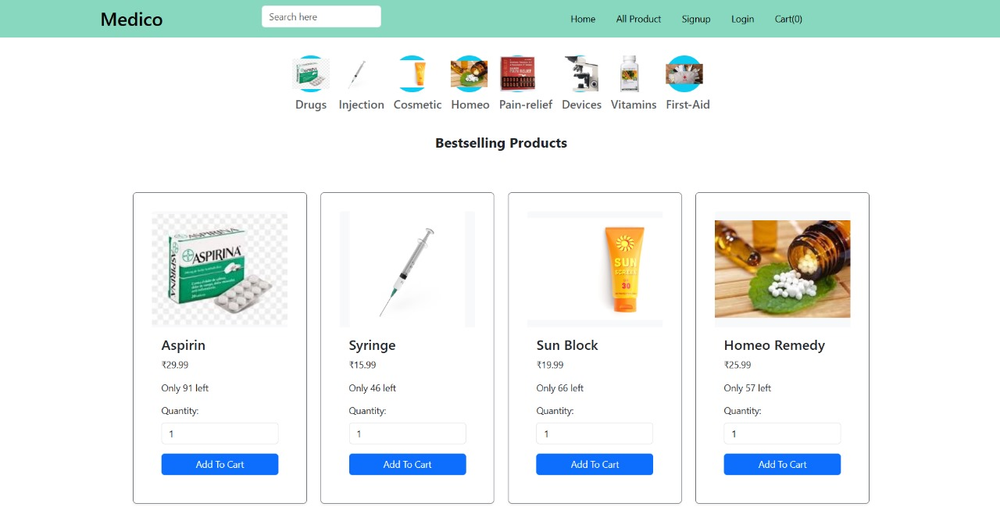
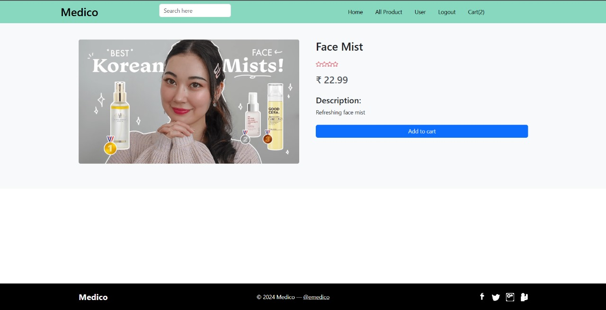
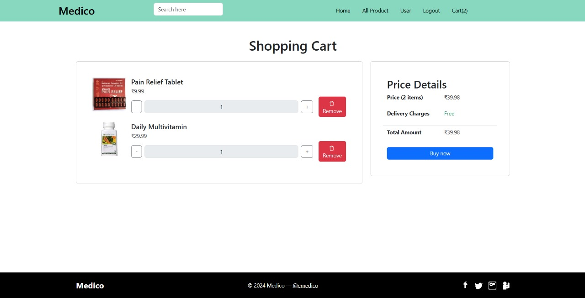
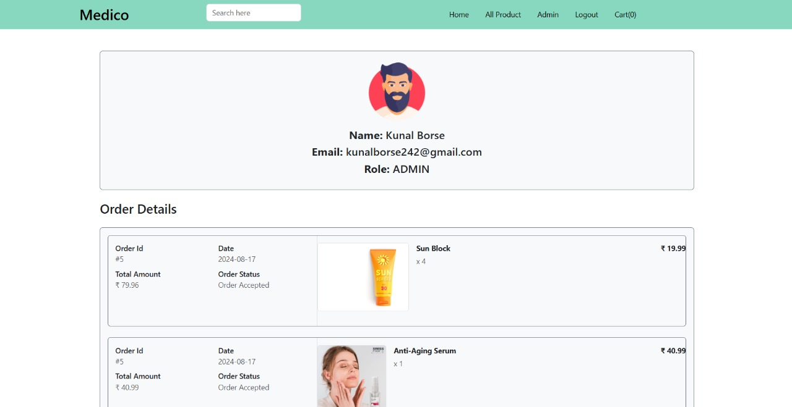
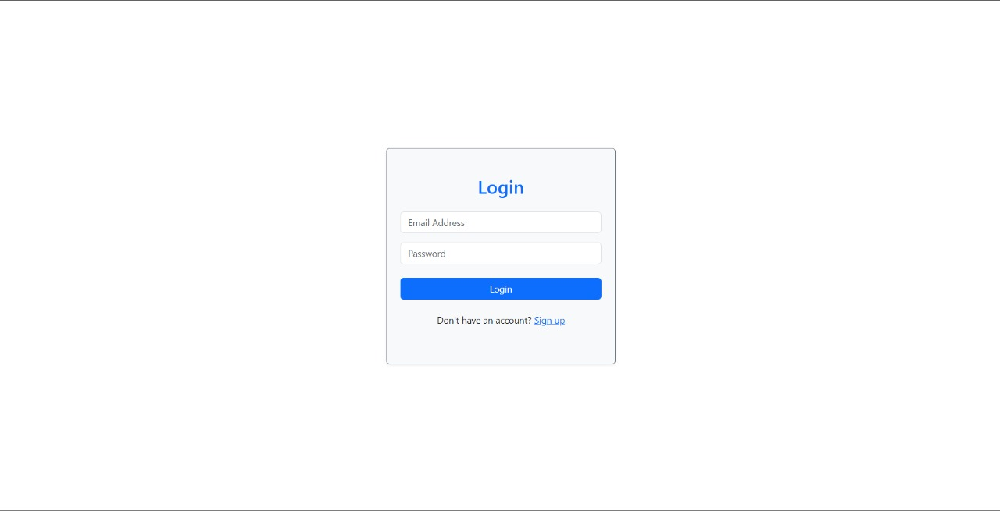
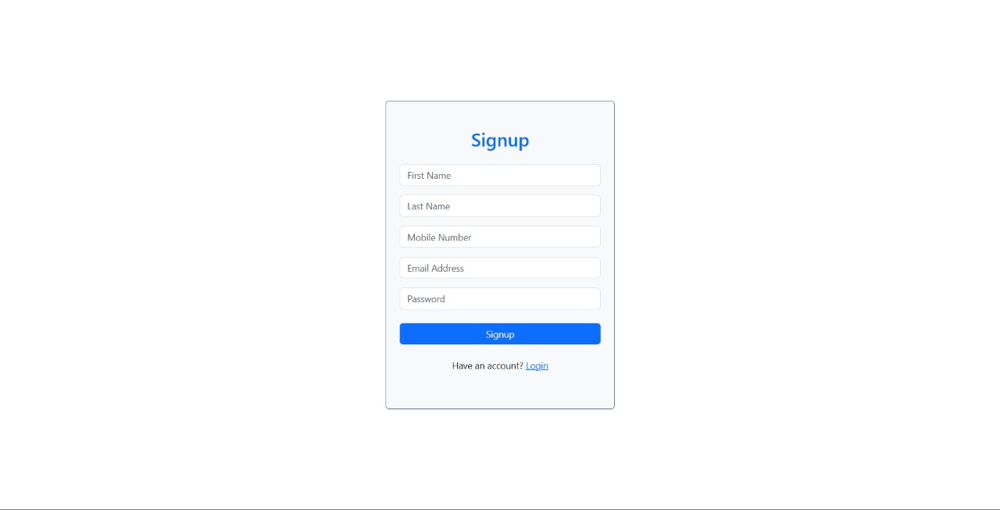

# Medico – Online Medical Store

A full-stack online medical store: customers browse and order healthcare products (drugs, injections, cosmetics, homeopathy), and admins manage the catalogue, orders and users. Spring Boot REST API with JWT auth and a React storefront.


[](LICENSE)

## Screenshots

| Home | Product details |
|------|-----------------|
|  |  |
| **Cart** | **Admin dashboard** |
|  |  |
| **Login** | **Register** |
|  |  |

## Features

**Customers**
- Register and log in (JWT-based authentication)
- Browse products by category, search by keyword, view product details
- Add products to a cart and place orders
- User dashboard with order history
- Manage delivery addresses

**Admins**
- Role-protected admin dashboard (`ADMIN` authority)
- Add, update and delete products (including product images) and categories
- View all orders and update order status
- View and delete users

**API**
- REST endpoints under `/api` (public, user and `/api/admin` routes)
- Role-based access control with Spring Security
- Swagger UI / OpenAPI docs via springdoc

## Tech stack

| Layer    | Technologies |
|----------|--------------|
| Backend  | Java 17, Spring Boot 3.0, Spring Web, Spring Data JPA (Hibernate), Spring Security, java-jwt, ModelMapper, Lombok, springdoc-openapi |
| Database | MySQL |
| Frontend | React 18 (Create React App), React Router 6, Redux Toolkit, Axios, Bootstrap 5 / React-Bootstrap, react-hot-toast |

## Getting started

### Prerequisites
- JDK 17
- MySQL running locally
- Node.js and npm

### Backend (`Medico/`)

Database settings are read from environment variables (with local defaults) in `Medico/src/main/resources/application.properties`:
`DB_HOST`, `DB_PORT`, `DB_NAME` (default `ecommerceappdb`), `DB_USERNAME`, `DB_PASSWORD`.

```bash
cd Medico
./mvnw spring-boot:run
```

The API starts on `http://localhost:8080`; Swagger UI is at `http://localhost:8080/swagger-ui/index.html`.

### Frontend (`my-app (copy)/my-app (copy)/`)

```bash
cd "my-app (copy)/my-app (copy)"
npm install
npm start          # http://localhost:3000
```

Sample category/product data is in `Products.sql` in the frontend folder.

## Project structure

```
Medico/                      Spring Boot backend
  src/main/java/com/app/
    config/                  security, CORS and app config
    controllers/             REST controllers (auth, products, categories, orders, users, addresses)
    entities/                JPA entities
    payloads/                DTOs
    repositories/            Spring Data repositories
    security/                JWT filter and utilities
    services/                business logic
my-app (copy)/my-app (copy)/ React frontend
Photos/                      screenshots
```

## License

Released under the [MIT License](LICENSE).
